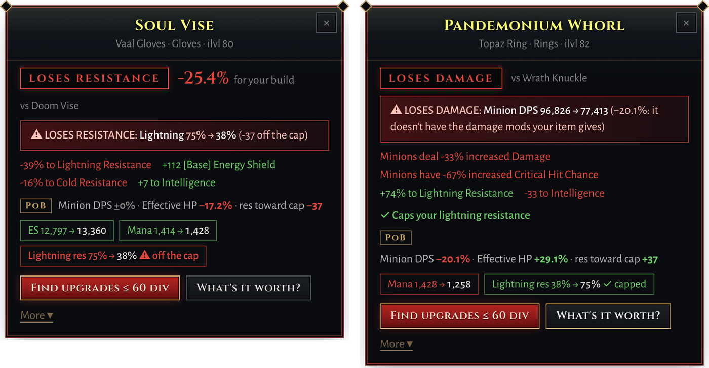
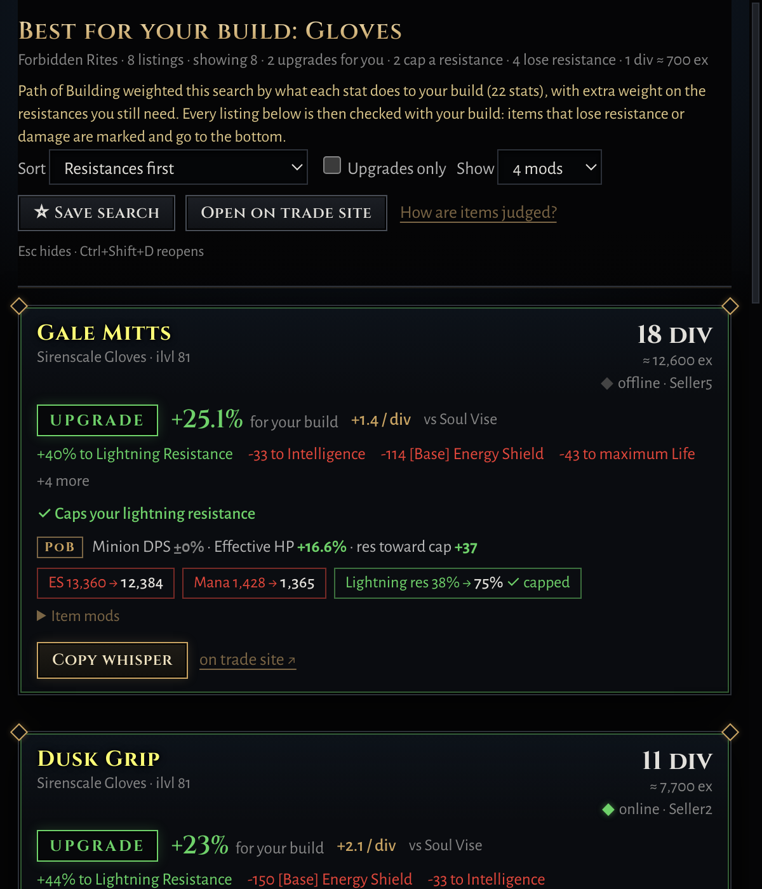

  
  
  
  

<b><a href="https://poe2upgrade.com">poe2upgrade.com</a></b>

**PoE2 Upgrade Checker** is a small overlay that sits in your system tray while you play Path of Exile 2. It answers two questions in game:

| | |
|---|---|
| **Is this an upgrade?** Hover an item and press **F2**. With your Path of Building export loaded, the app runs **Path of Building's own calculations** on your build: what the item does to your DPS (or minion DPS), effective HP, resistances and Spirit compared with what you wear. Items that would drop a resistance or cost you damage are flagged in red, never called an upgrade. |  |
| **Where's a better one?** One click searches the official trade site for upgrades within your budget, weighted by what each stat is worth to your build. Results open in the app, judged against your gear, with *Travel to hideout* and a ready-made whisper. | |

Screenshots of the app with a real Path of Building build (a Disciple of Varashta summoner). Trade listings in them are examples.

## Download

1. Get **`PoE2-Upgrade-Checker-Setup-x.y.z.exe`** from the [latest release](https://github.com/ets-public/poe2-upgrade-checker/releases/latest) and run it. It installs for your Windows user only, so no admin rights are needed, and **updates itself**. The wizard lets you change the folder (it suggests `%LOCALAPPDATA%\Programs\poe2-upgrade-checker`); updates keep installing where you put it.
   - Prefer no install? Use the **Portable** .exe from the same page. It doesn't auto-update.
   - Windows may warn about an unrecognised app because the installer isn't code-signed. Click *More info → Run anyway*.
2. In PoE2, go to **Options → Graphics** and set **Windowed Fullscreen**, so the overlay can draw over the game.
3. Hover an item and press **F2**. The first-run guide walks you through adding your Path of Building build and your gear.

**On Linux?** See [Linux (experimental)](#linux-experimental).

## Features

- **Judged by Path of Building, for any build:**
  - Paste your PoB2 export on *My gear*. The app bundles Path of Building's calculation engine and checks every item against your build: DPS / minion DPS, effective HP, resistances against the cap, Spirit, attribute requirements.
  - *Find upgrades* builds its trade search with Path of Building's own search generator (like PoB's Trader), then checks every listing exactly.
- **Resistances come first:**
  - Items that cap a resistance you're short of are marked "✓ Caps your … resistance" and go to the top of trade results.
  - Items that drop a resistance off the cap get a red **LOSES RESISTANCE** verdict with exactly what drops, e.g. "Lightning 75% → 38%".
  - **Chaos Inoculation** is recognised, and chaos resistance is then ignored everywhere.
- **Never breaks your build:** an item that costs a big part of your damage (**LOSES DAMAGE**), leaves you short of Spirit or can't be worn is flagged, however much else it adds. Each check can be switched off under *Priorities*.
- **Character page:** your whole character from Path of Building: DPS or minion DPS, effective HP, energy shield, resistances against the cap, the biggest hit you can take, Spirit, attributes, skills with supports, keystones and ascendancy.
- **Upgrade popup:** the verdict, the change in every stat, open prefixes and suffixes for crafting, and *What's it worth?*
- **Trade search:**
  - *Better for my build*, *same stats or better*, *craftable bases*, or a custom search built from any of the trade site's ~3,600 stats.
  - Price range in divines (or exalts, using poe.ninja's live rate), ignored and excluded stats, and saved searches with **new-listing alerts**.
- **Your gear:**
  - Every slot, including weapon swap, jewels, flasks and charms.
  - Import from Path of Building (pobb.in links or codes).
  - Several characters, each with their own gear and build.
- **Gear score fallback:** without a PoB build, a 0–100 gear score from build profiles (minion summoner, ES caster, life + res) and your own stat weights.
- **Built for playing:**
  - Compact popup.
  - Pin it to the cursor or a screen edge.
  - Text size and colour-blind options.
  - Starts with Windows.

## In pictures

Items that cost you a resistance or your damage are never called an upgrade.

<table>
<tr>
<td width="42%"></td>
<td>  </td>
</tr>
<tr>
<td>Trade results: every listing checked with your build, the ones that cap a resistance first.</td>
<td>The Character page, and My gear with your build and priorities.</td>
</tr>
</table>

## Fair play and privacy

- **Nothing touches the game:**
  - It never reads game memory and never injects anything.
  - Its only input to the game is **one Ctrl+C per hotkey press**, the same as copying an item yourself.
- **Where data goes:**
  - It talks to the official trade site (pathofexile.com), poe.ninja and GitHub (for updates), nothing else. Path of Building runs locally on your PC.
  - Your gear and settings stay on your PC, in `%APPDATA%\poe2-upgrade-checker`.
- **Signing in is optional** and only used for *Travel to hideout* and bigger searches. You sign in on pathofexile.com's own login page, and the app only keeps the resulting login cookie, on your PC.
- **Not affiliated:** this is a fan-made tool, not affiliated with or endorsed by Grinding Gear Games.

## First-time setup

The **setup guide** opens on first run. You can reopen it from **My gear → Setup guide**.

1. **Paste your Path of Building export** (PoB2: *Import/Export Build → Generate*, or a pobb.in link) on *My gear*. This is what makes the verdicts exact, for **any class and skill**: the app runs Path of Building's calculations on your build. It also fills your gear slots.
2. **Copy what you wear:** open your character screen, hover each item, press **F2**, then click **Set as …** in the popup. Items copied in game replace PoB's in the calculation, so it uses exactly what you have on.
3. Check your **resistances** on My gear. They're filled in from PoB; if PoB's numbers disagree with your character sheet, My gear tells you (usually a charm or buff ticked in PoB's Configuration tab).
4. Check that PoB's **main skill** and **Configuration** match how you play: the verdicts are only as good as the build you give it.
5. Set your **Priorities** on My gear (the defaults suit most builds) and, if you like, the damage vs survivability slider.

**Characters:** the selector on My gear keeps separate gear, build and resistances for each character.

## Character page

**Character** in the sidebar shows your character as Path of Building calculates it, with the gear you copied in game:

- **At a glance:** class, ascendancy, level, passive points, main skill, Chaos Inoculation, and big numbers for (minion) DPS, effective HP, energy shield, mana, free Spirit and movement speed.
- **Minions:** DPS, average hit, uses per second, crit chance and damage, life, armour, effective HP and resistances.
- **Defences:** effective HP, energy shield with its recharge, life, ward, armour and physical reduction, evasion, block, stun and ailment thresholds.
- **Resistances** as bars against your cap (with how far over or short), and the **biggest hit you can take** of each damage type.
- **Spirit & mana**, **attributes** against your gear's requirements, charges, presence radius.
- **Skills** with their supports (main skill first), **passive tree** keystones, ascendancy and notables, and your **gear** with gear scores.

It updates when you change gear or switch character; *Recalculate* reruns it. Without a PoB build it shows your resistances and gear and how to get the full sheet.

## The popup

- **Verdict:** **UPGRADE**, **SMALL UPGRADE**, **SIDEGRADE**, **DOWNGRADE**, **UPGRADE, BUT…** (with the reason), **LOSES RESISTANCE** or **LOSES DAMAGE**, e.g. "+12.4% for your build vs Doom Vise". Underneath: what Path of Building says changes (minion DPS, effective HP, ES, Spirit, each resistance against its cap).
- **Compact view:** you see the top changes and two buttons, **Find upgrades** and **What's it worth?**. Click **More** for the full change table, Set as …, Items like this one, Craftable bases and Custom search. Settings → Popup can make **Full** the default.
- **Craft info:** with *advanced item descriptions* turned on in game, the popup shows open prefixes and suffixes, e.g. "Open: 2 prefixes, 2 suffixes – craftable".
- **Uniques** get a Path of Building verdict too, plus *What's it worth?* and *Find cheaper copies*. **Unidentified** items aren't rated.
- While the game copies, the popup shows "Reading item…". If you press **Ctrl+C** yourself on something that isn't gear (currency, gems), no popup appears.
- **Settings → Popup:** position (next to the cursor, left, right or top of the screen), text size, a colour-blind palette (blue and orange), and prices shown in both units, e.g. "220 ex (≈0.3 div)".

## Verdicts by Path of Building (any build)

With your PoB export loaded, every item (in the popup and in trade results) is checked by swapping it into your build in Path of Building and comparing the numbers:

- **Damage:** your Full DPS if your PoB adds skills up, otherwise your minions' DPS (summoners), otherwise your main skill's DPS.
- **Survivability:** PoB's effective HP, which accounts for life, energy shield, resistances and mitigation.
- **The score** is the % change, weighted 60/40 damage/survivability by default (slider on My gear). +3% or more is an **UPGRADE**, +1% to +3% a **SMALL UPGRADE**, within ±1% a **SIDEGRADE**.
- **Priorities** (My gear), all on by default except chaos:
  - **Cap my resistances first:** while a resistance is under the cap, each point an item adds toward it counts +0.5% on its score, and *Find upgrades* gives the resistances you still need extra weight. *Including chaos* counts chaos resistance too (ignored with Chaos Inoculation).
  - **Never lose damage:** an item that costs more than 5% of your damage is **LOSES DAMAGE**, however much resistance or life it adds, and *Find upgrades* only looks at listings with as many of your damage mods as the item you wear (up to 2).
  - **Never run short of Spirit** and **Keep attribute requirements met:** otherwise it's **UPGRADE, BUT…** at best, with the reason.
- **Losing resistance** (off the cap, or further under it) is always its own red **LOSES RESISTANCE** verdict with a banner.
- **Rings** are tried in both ring slots; the better one counts.

- **Jewels** are tried in every jewel socket you've allocated on your PoB tree, replacing the jewel there (or in an empty socket); the best socket counts, and the verdict says which one, e.g. "vs Entropy Star (Socket #2)". *Find upgrades* for a jewel uses PoB's jewel search (radius jewels as radius jewels).

Anything PoB can't read falls back to the gear score below.

## Finding upgrades

- **Find upgrades** (in the popup, or next to each slot on My gear) runs **Better for my build** for that slot:
  - With PoB: Path of Building weights the search by what every mod that can roll there is worth to your build, then each listing is judged exactly. The trade site limits how big a search can be, so signing in (Settings → Trade site account) allows a fuller one.
  - Without PoB: listings that beat your gear score in that slot, with at least two of the slot's key stats.
- The **Find upgrades** page has everything in one bar: the item, price range, currency, sellers and league, with ignored stats and saved searches next to it. It lists your equipped items and the items you copied recently. Its other searches:
  - **Same stats or better** than your item. Every mod becomes a filter with your value as the minimum, and one may be missing if the item has 4 or more. If nothing is listed, it loosens to 90%, then 80%, then 65% and tells you which level found listings. Rune and enchant bonuses are left out, because you can socket your own. Uniques are searched by name.
  - **Craftable bases:** rare, uncorrupted bases of the same type with the slot's key stats rolled high and an open prefix and suffix.
  - **Custom search:** untick stats you don't want, change the minimums or set them all to 90% / 80% / 70%, and add any trade-site stat, then **Search with ticked stats**.
  - **By my weights** (only when your build is turned off): anything that scores higher with your own stat weights.
- **Items like this one** (popup, for something you copied that isn't equipped) searches for that item's stats.
- **Ignored stats:** tick e.g. *All resistances* if you don't want them to count. **Ignore** leaves them out of scores and searches; **Exclude listings with it** also hides listings that have them. Click **⊘** next to any stat in the popup to ignore just that one.
- **Stat database:** the **Browse stats…** buttons open a searchable list of every stat the PoE2 trade site knows, filterable by kind (explicit, implicit, rune, desecrated…) and by what you've seen on that item type.
- **Sellers:** the default is *Instant Buyout + In Person*. "In Person (online) only" leaves out merchant listings, which are most of the market.
- **Price range:** e.g. "from 5 to 20 Divine Orbs". The minimum filters out cheap junk; leave either end empty for no limit. The Divine→Exalted rate comes from poe.ninja (current league, refreshed hourly), so exalt-priced listings are included too.
- The league defaults to the current challenge league and is remembered when you change it.

## Gear score (without Path of Building)

Without a PoB build (or for items PoB can't read), every item gets a **gear score from 0 to 100** for how useful it is to your character, with a grade: **S** 85+, **A** 70+, **B** 55+, **C** 40+, **D** below that. Pick the closest profile under **Build & stats** (importing a PoB build picks one for you). The minion summoner profile, for example:

- **Weapon / focus / amulet / helmet:** + Level of all Minion Skills.
- **Sceptre:** Spirit and ally damage.
- **Body armour and amulet:** Spirit.
- **Armour pieces:** Energy Shield.
- **Rings:** minion damage and crit.
- **Boots:** movement speed.
- **Everywhere:** resistances, life, mana and Intelligence.

Each slot is scored only on stats that can roll there. A perfect item for that slot is about 100, and stats your build doesn't use add nothing.

- **Popup:** shows the item's score next to yours, e.g. "45 C · Gear score · yours 56 (-11)". Click **why?** for the stats that scored, how good each roll is, what's missing, and which mods are useless to you.
- **Results window:** without a PoB verdict, every listing shows its gear score, and you can sort by **Best gear score**.
- **My gear tab:** shows each slot's score, your **overall gear score**, and **Upgrade first:** your three weakest slots. Click one to search for an upgrade.
- Stats you've set to ignore don't count. Uniques and unidentified items aren't rated.
- **Resistance caps:** resistance only counts up to your cap. If you're already capped on fire, fire res on a new item scores nothing, and **why?** says so.
- **Jewels, weapon swap:** jewels (6 slots), Weapon 2 and Offhand 2 are tracked and scored too. Open *Weapon swap, flasks, charms & jewels* under the slot list on My gear. The overall score uses main gear only.
- **Build & stats page:** choose a profile (**Minion summoner (ES)**, **ES spellcaster**, **Life + res**, or off) and use the **gear score editor**: for each stat, set 0× to 3× how much it matters to you. *Reset* undoes it. *How the gear score works* explains it in the app.

## Trade results in the app

Searches show their listings in a **results window** (always on top) instead of the browser:

- Each listing is judged against what you wear, e.g. **UPGRADE +8.2% for your build**, with the stat changes and what Path of Building says underneath. Listings that lose resistance or damage get a red border and banner.
- **Sort** by *Resistances first* (the default with *Cap my resistances first*: items that cap one on top, items that lose one at the bottom), best upgrade, best gear score, **best value** (upgrade per divine spent), cheapest, or the trade site's order. Tick **Upgrades only** to hide the rest, and pick how many stat changes each card shows (3–8 or all).
- The header counts how many listings are upgrades for you, cap a resistance, or lose resistance or damage.
- **Travel to hideout** on Instant Buyout listings (sign in to pathofexile.com once the first time), **Copy whisper** for the rest, and **on trade site ↗** to open just that seller's listing in your browser.
- **Load 10 more**, **Open on trade site**, and **☆ Save search**.
- Prices in any currency are converted with poe.ninja rates, so 300 ex and 1 div compare correctly. If the listings can't be loaded, it opens the browser instead.

## More

- **What's it worth?** (popup) looks up listings like the copied item, ignoring your price range and ignored stats. It tells you the cheapest and typical price, e.g. "Worth about 2 div (cheapest 180 ex, 12 similar listed)", and shows them cheapest-first.
- **Saved searches** (Find upgrades page): run a saved search again with one click. It shows how many are listed now, e.g. "31 listed (+6 since last time)".
- **Alerts:** tick **Alert** on a saved search and choose how often to check. New listings give a Windows notification; click it to see them. Checks are spaced out to respect the trade site's rate limits.
- **Results window:** Esc hides it, and **Ctrl+Shift+D** (changeable in Settings) shows it again. It remembers its size and position, and comes back to the front when you search from the app.
- **Trade site account (optional):** Settings → Trade site account opens the pathofexile.com login inside the app. Signed in, searches can be bigger (more weighted stats) and *Travel to hideout* works from the app.
- **Searches pace themselves** to the trade site's rate limits (read from its replies), so you don't get locked out for a minute.
- **Settings → Startup:** start with Windows (quietly in the tray), and choose whether the main window opens on start.

## Support

Questions, bugs or ideas: email **[support@poe2upgrade.com](mailto:support@poe2upgrade.com)** or [open an issue](https://github.com/ets-public/poe2-upgrade-checker/issues). If F2 or a verdict looks wrong, attach the log (Tray → Open log) and, for a verdict, your pobb.in link.

## Hotkey & troubleshooting

- Change the hotkey under **Settings → Hotkeys**. Click the box, press your keys, then click Save.
- **Show a test popup** checks that the overlay can draw at all.
- **Open log file** shows what happened on each press. It's also in the tray menu.
- Nothing happens in game? Check the tray menu says "Hotkey: F2", that PoE2 is in Windowed Fullscreen, and what the log says.
- **When F2 finds nothing**, the popup says why, e.g. the game wasn't the active window, the mouse wasn't over the game, or the game runs as administrator (Windows then blocks the app's Ctrl+C; start the game normally).
- The app takes care of the usual causes itself: if one of its own windows is in front (you clicked the results window), it brings the game back first, and if its popup is under the mouse, it hides it before copying. It still sends only **one** Ctrl+C per press.
- The popup closes when you move the mouse away from it, when you click ×, or after the time set in Settings. Esc is left to the game.

## Linux (experimental)

For PoE2 running through **Steam with Proton** (or Lutris/Heroic) on desktop Linux: Ubuntu, Fedora, Arch, Bazzite and so on, on X11 or Wayland.

1. Download **`PoE2-Upgrade-Checker.AppImage`** from the [latest release](https://github.com/ets-public/poe2-upgrade-checker/releases/latest) and put it where you want to keep it (e.g. `~/Applications`).
2. Make it executable and run it: right-click → Properties → *Allow executing as program*, or `chmod +x PoE2-Upgrade-Checker.AppImage && ./PoE2-Upgrade-Checker.AppImage`. It **updates itself** like the Windows installer, in place: the file keeps its name, so shortcuts and *Start with your desktop* keep working.
   - Had a version-named file from 0.4.1 or older (`PoE2-Upgrade-Checker-0.4.1.AppImage`)? Its next update renames it to `PoE2-Upgrade-Checker.AppImage` once: start it from the new name (that also fixes the autostart entry) and update any shortcut you made.
   - Some distros need FUSE for AppImages (e.g. `sudo apt install libfuse2` on Ubuntu 22.04+).
3. In PoE2 use **Windowed Fullscreen**, hover an item and press **F2**.

How it works on Linux, and what to check if F2 doesn't:

- **Path of Building** runs inside the app as on Windows (a bundled LuaJIT), so verdicts are the same.
- **Sending Ctrl+C to the game** uses X11's XTest through the `python3` that comes with almost every distro – nothing to install. The game runs under Proton as an X11 window, so this also works on **Wayland** desktops (through XWayland). If `python3` or the X11 libraries are missing, the app uses `xdotool` if it's installed; otherwise press **Ctrl+C** on the item yourself – the app picks it up from the clipboard.
- **The F2 hotkey** works while the game (or another X11 window) is focused. On some Wayland desktops global hotkeys don't reach native Wayland windows; in game that doesn't matter.
- The app runs as an X11 app (XWayland on Wayland) so it can put the popup next to the mouse.
- **Steam Deck:** desktop mode works like any Linux desktop; gaming mode doesn't allow other windows over the game.
- Not working for you? Please [open an issue](https://github.com/ets-public/poe2-upgrade-checker/issues) with your distro, desktop (GNOME, KDE…), X11 or Wayland, and the log (tray → Open log file). It's in `~/.config/poe2-upgrade-checker`.

## Notes / limits

- **Stash value tracking was taken out** until GGG releases a stash API for PoE2 (their developer docs list it as PoE1 only). Reading tabs from screenshots or via public tabs wasn't reliable enough.
- Flasks and charms can be saved but aren't scored.
- The *Never lose damage* and Spirit/attribute checks need Path of Building; the gear score fallback doesn't have them.
- Two-handers are compared against your weapon plus offhand together.
- Your data (gear, the imported build, the trade-site sign-in) lives in a **`poe2-upgrade-checker-data` folder next to the install folder** – `%LOCALAPPDATA%\Programs\poe2-upgrade-checker-data` by default, on whatever drive you installed to. It isn't inside the install folder because Windows updates delete that; keeping it beside means updates and uninstalls leave it alone. The portable .exe keeps its data in the folder the .exe is in. If that place can't be written (an all-users install in `Program Files`), it falls back to `%APPDATA%\poe2-upgrade-checker`; running from source (`npm start`) uses that profile folder, and `POE2UC_DATA_DIR` points it anywhere. On the first start after updating, what an older version saved in `%APPDATA%` is moved over, so nothing is lost.

## Dev

- `test-build.bat` builds a local portable test .exe (no release) and checks the PoB engine starts (`tools/pob-smoke.js`).
- The look is **Wraeclast Iron**; colours, type, components and rules are in [DESIGN.md](DESIGN.md).
- `npm test` runs the parser, scorer, trade-query, listing, PoB import and PoB verdict tests.
- `node tools/get-pob.js` downloads the pinned Path of Building into `vendor/pob` and builds `pobhost.exe` (a small host for PoB's LuaJIT, compiled with the C# compiler that ships with Windows). The build scripts run it for you.
- `build-exe.bat` (or `npm run dist`) builds the installer and the portable .exe locally, without publishing, and then clears this machine's saved data (the imported PoB build and the trade-site sign-in) so the build starts like a first install. On Linux, `npm run dist:linux` builds the AppImage (needs git, gcc and make for the Path of Building engine). Testing locally (`npm start`, `test-build.bat`) keeps the data, and `npm run clean:data` clears it by hand (`node tools/clean-app-data.js` only shows what it would delete; add `--keep-settings` to keep gear, settings and hotkeys).
- **Releasing a new version:** double-click `release.bat`. You need [Git for Windows](https://git-scm.com/download/win) installed once. The script then does everything else:
  1. It picks the next version and asks you to confirm with Enter.
  2. It turns *Unreleased* in `CHANGELOG.md` into this version's release notes.
  3. It uploads to GitHub and tags the version.
  4. GitHub Actions builds the installer and the portable .exe on Windows, runs the tests and attaches both to the release with the notes.
  5. It waits for the build, then opens the release page. If the build failed, it opens the log instead.
  - Options: `release.bat -Version 0.5.0` (pick the number), `-Yes` (no questions), `-NoWait` (don't wait for the build).

## Credits

- Calculations: [Path of Building Community (PoE2)](https://github.com/PathOfBuildingCommunity/PathOfBuilding-PoE2) (MIT), bundled unmodified and run headless.
- Fonts: [Cinzel](https://github.com/NDISCOVER/Cinzel) and [Alegreya Sans](https://github.com/huertatipografica/Alegreya-Sans), both under the SIL Open Font License (bundled in `assets/fonts`).
- Prices: [poe.ninja](https://poe.ninja). Trade data: the official [Path of Exile trade site](https://www.pathofexile.com/trade2).
- Path of Exile is a trademark of Grinding Gear Games. This project isn't affiliated with or endorsed by them.
