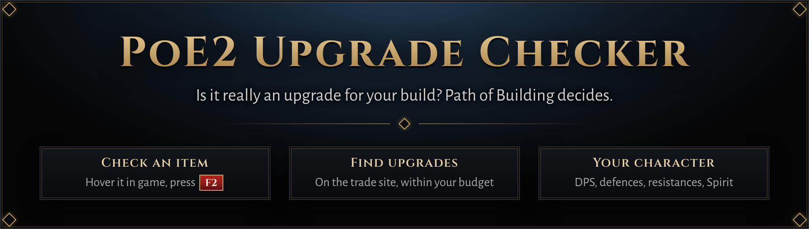
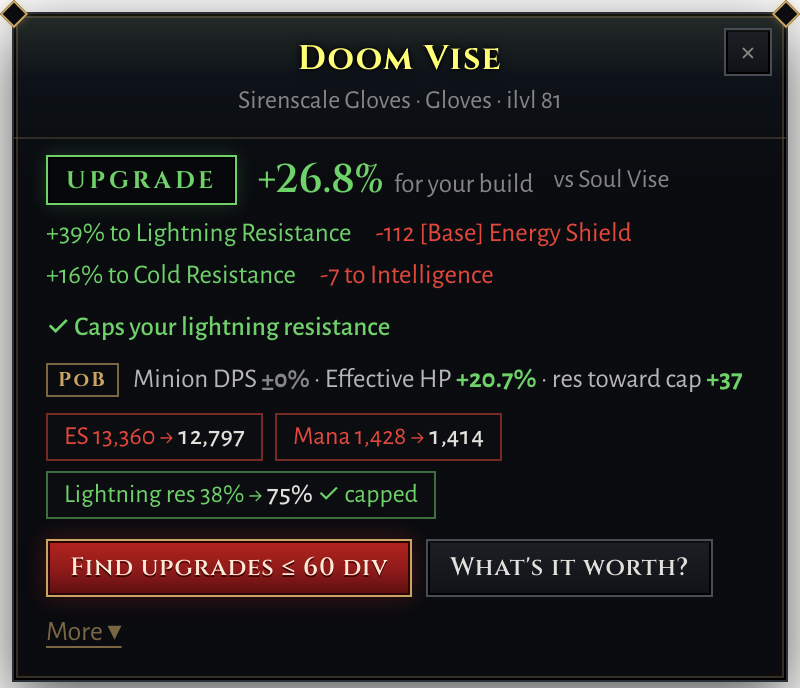
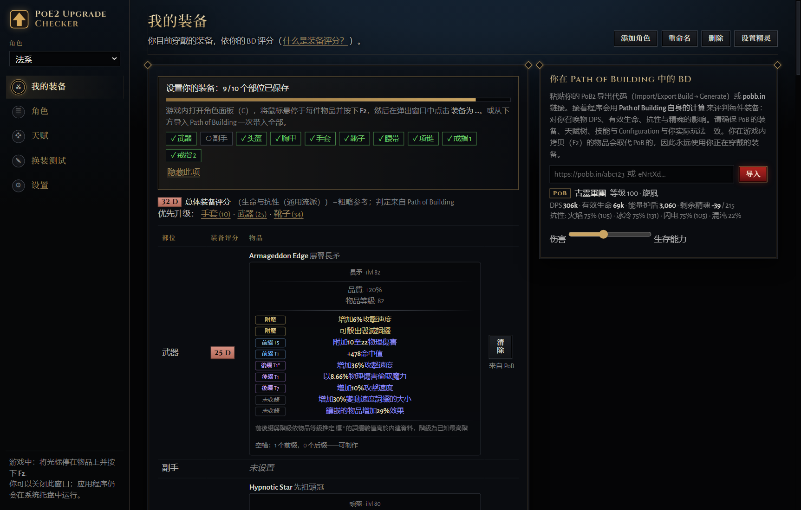
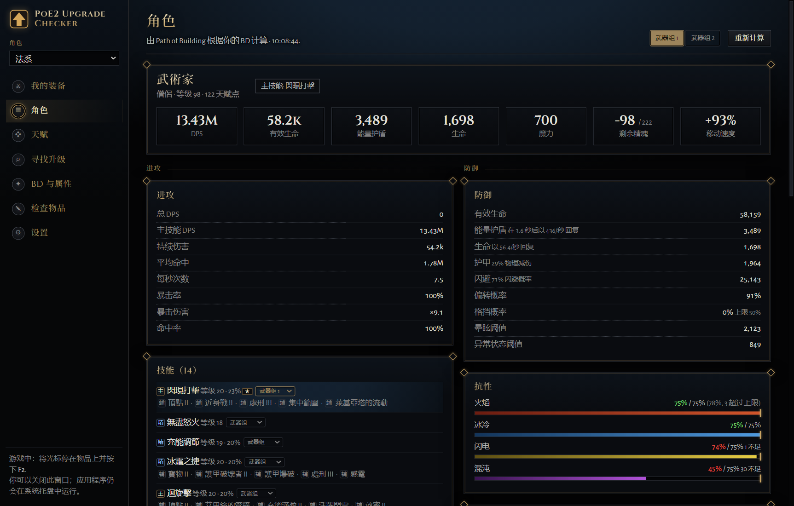

  
  
  

> **本仓库是 [ets-public/poe2-upgrade-checker](https://github.com/ets-public/poe2-upgrade-checker) 的中文修改版。**
>
> 相对原项目，本分支做了以下改动：
>
> - **中文版适配国际服繁体**：完整繁体中文（繁體中文）界面与术语，对齐《流放之路 2》国际服 / 台服（國際服 / 台服），沿用官方台服客户端译名（精魂、能量護盾、混沌淨化……）；另含简体中文。
> - **天赋树展示**：新增独立的「天賦」页，用 Path of Building 的天赋树数据在画布上画出整棵 PoE2 天赋树，高亮已点路径，支持缩放、拖拽、悬停查看属性与搜索。
> - **轻度 PoB 功能**：内嵌 Path of Building 计算引擎，提供「角色」页按 PoB 计算展示整套角色面板，以及属性来源明细，相当于内置了一个轻量配装 / 角色查看器。

## 核心功能

### 1. 导入 Path of Building 链接

在「我的裝備（My gear）」中粘贴你的 PoB2 导出 —— 支持 *Import/Export Build → Generate* 生成的代码、pobb.in 链接或代码。应用内嵌 Path of Building 计算引擎（本地运行，不上传），据此计算你角色的面板，并以此为基准判定每件装备的取舍。支持多个角色，每个角色独立保存配装与 build。

### 2. 装备查看

- 游戏内悬停一件装备按 **F2**，弹出悬浮窗显示它与你当前配装的对比判定：是否升级、各项属性变化（伤害、有效生命、抗性是否掉下上限、精魂等）。
- 「我的裝備」页按槽位展示全身装备（含武器切换、珠宝、药剂、护符），导入 PoB 后自动填槽。
- 「角色」页按 Path of Building 的计算展示：伤害 / 召唤物伤害、有效生命、能量护盾、抗性（对比上限）、最大承伤、精魂、属性、升华与关键天赋、装备评分等。

 

### 3. 技能与天赋查看

- **天賦页**：用 PoB 的天赋树数据在画布上绘出整棵 PoE2 天赋树，高亮你已点的路径；可缩放、拖拽、悬停查看节点属性、搜索节点。
- **角色页**：展示技能及其辅助（主技能优先）、升华、关键天赋，以及属性来源明细（悬停 / 点击可查看某条角色属性的来源）。

## 其他功能（简略）

- **交易站找装**：按 PoB 权重生成搜索，逐条判定交易 listing 是否对你升级；价格用 poe.ninja 实时汇率换算（神聖 / 崇高）。
- **装备评分**：无 PoB 时，按职业模板与自定义权重给出 0–100 的评分与 S/A/B/C/D 等级。
- **公平与隐私**：不读取游戏内存、不注入；每次热键仅发送一次 Ctrl+C。配装、build 与登录 cookie 只存在于本机，仅与官方交易站、poe.ninja、GitHub（检查更新）通信。
- **设置**：热键、悬浮窗位置 / 字号 / 色盲配色、开机启动等。
- **使用前置**：游戏内「选项 → 画面」需设为**窗口化全屏**，悬浮窗才能叠加在游戏之上。

## 与原项目的关系 / 致谢

- 计算引擎：[Path of Building Community (PoE2)](https://github.com/PathOfBuildingCommunity/PathOfBuilding-PoE2)（MIT），原样内嵌、无头运行。
- 字体：Cinzel、Alegreya Sans（SIL Open Font License）。
- 价格数据：[poe.ninja](https://poe.ninja)；交易数据：官方 [Path of Exile 交易站](https://www.pathofexile.com/trade2)。
- 原项目：[ets-public/poe2-upgrade-checker](https://github.com/ets-public/poe2-upgrade-checker)。
- 《流放之路》是 Grinding Gear Games 的商标。本项目为玩家制作，与该公司无关联、未获其背书。
